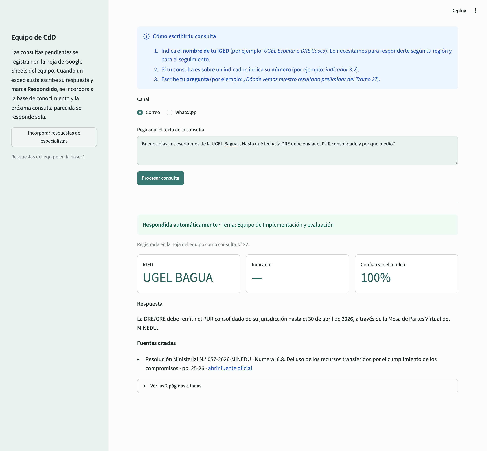
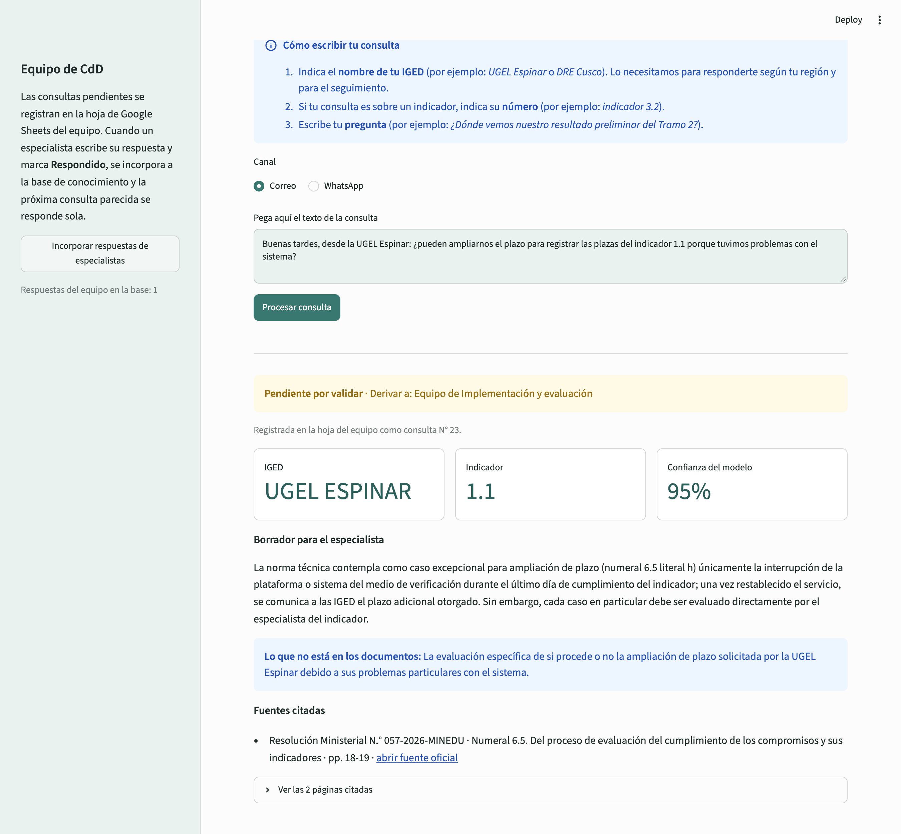
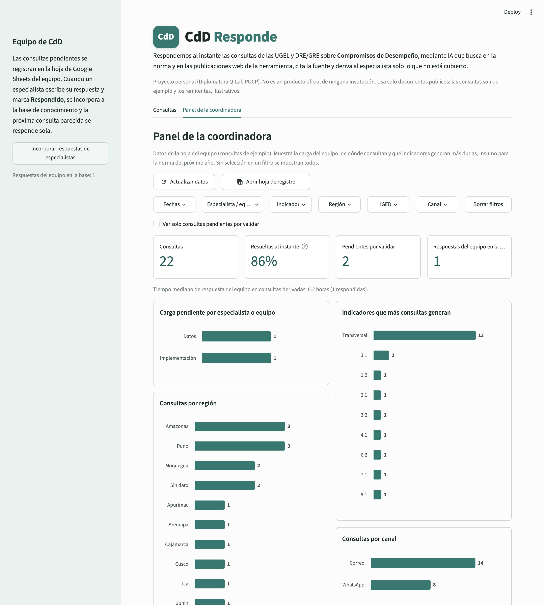
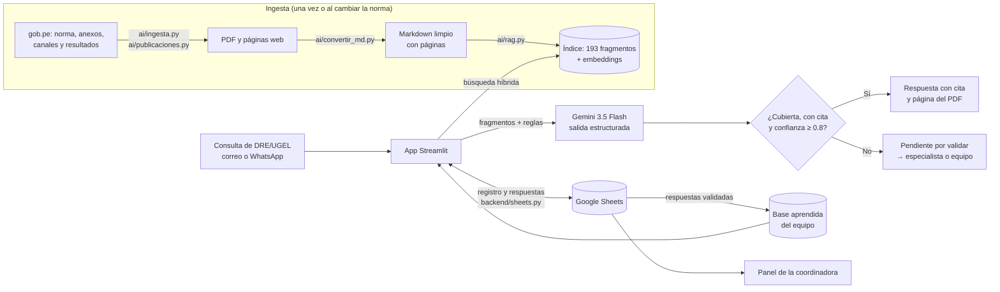

# CdD Responde

*Repositorio: `responde-cdd`*

> **Respondemos al instante las consultas de las UGEL y DRE/GRE sobre Compromisos de Desempeño, mediante IA que busca en la norma y en las publicaciones web de la herramienta, cita la fuente y deriva al especialista solo lo que no está cubierto.**

**Demo en vivo:** https://responde-cdd.streamlit.app/ · **Video de respaldo:** 🔴 POR COMPLETAR

> ⚠️ Proyecto personal desarrollado para el proyecto final de la Diplomatura de Ciencia de Datos para las Ciencias Sociales y la Gestión Pública (Q-Lab PUCP). **No es un producto oficial de ninguna institución.** Usa solo documentos públicos de gob.pe; las consultas del demo son de ejemplo, los remitentes son ilustrativos y los especialistas, ficticios.

---

## 1. One-liner

Respondemos al instante las consultas de las UGEL y DRE/GRE sobre Compromisos de Desempeño, mediante IA que busca en la norma y en las publicaciones web de la herramienta, cita la fuente y deriva al especialista solo lo que no está cubierto.

## 2. Founder


**Josselin Yauri** · Soy economista de la Universidad del Pacífico y actualmente trabajo en la Unidad de Financiamiento por Desempeño del Ministerio de Educación, en la herramienta Compromisos de Desempeño. Conozco de primera mano las consultas que llegan de las IGED, cómo se responden y qué información pública existe para responderlas.

**Cómo cubro cada rol con agentes de IA:** producto y decisiones de dominio (yo: qué responde sola la herramienta, a quién se deriva cada tema, qué se publica); ingeniería con Claude Code como co-founder técnico (ver sección 9); diseño de la app y del panel iterado con Claude Code a partir de mi revisión; ventas: yo presento el piloto directamente al equipo y a la coordinación (ya lo mostré en las conversaciones de [`docs/research/`](docs/research/)); con Claude Code preparé el modelo de precios y la estimación del costo por consulta (sección 7); el argumento de venta es el propio panel, que mide cuántas consultas se resuelven al instante y la carga pendiente del equipo.

## 3. Problema

**Quién lo sufre:** el equipo de especialistas que atiende las consultas sobre los Compromisos de Desempeño (CdD) 2026, un mecanismo de financiamiento por desempeño en el que participan **190 IGED** (DRE/GRE y UGEL) con resultados publicados, de las **250** listadas en el Anexo N° 1 de la Norma Técnica (RM 057-2026-MINEDU).

**Cómo se resuelve hoy** (según la experiencia de la founder en el equipo):
- Las consultas llegan por **correo** y a veces por **WhatsApp**.
- Se registran a mano en un **Excel** (de qué UGEL o DRE/GRE consultan y la temática), que luego se usa para analizar de dónde consultan más y qué temas no están claros.
- Cada especialista responde las de sus indicadores; la **coordinadora revisa** las respuestas antes de enviarlas, aunque no siempre tiene tiempo.
- Muchas respuestas **ya están en la norma** o en las publicaciones web, pero hay que buscarlas en un documento de **183 páginas** que además tuvo una modificatoria que luego se dejó sin efecto (RM 253-2026 → RM 310-2026).

**Cuánto les cuesta:** en las 3 conversaciones nadie dio cifras (consultas por semana, minutos por consulta), así que no las reportamos. Lo que sí dijeron las tres personas:
- Armar las respuestas **toma tiempo**, y también **sistematizar** (registrar) las consultas.
- En muchas etapas el equipo está **cargado con otras tareas** y además debe responder las consultas.
- Las consultas llegan **siempre**, por WhatsApp o correo.

Medir el volumen real es justamente uno de los primeros resultados del piloto: el panel cuenta las consultas por canal, tema e IGED.

**Evidencia:** notas de 3 conversaciones informales (no fueron entrevistas estructuradas) con 2 especialistas y la coordinación del equipo, publicadas sin nombres y con su consentimiento, en [`docs/research/`](docs/research/).

**Lo que cambiamos por esas conversaciones:**
- La coordinación notó que la herramienta podía no leer bien las **notas al pie**. Lo confirmamos en el numeral 6.5 f.ii y lo corregimos: cada nota al pie ahora queda junto al párrafo que la llama.
- En las conversaciones 1 y 2 se pidió cargar **más documentos de la herramienta** como fuentes, lo que quedó como siguiente paso (sección 7).
- En la conversación 1 se pidió explicar a las IGED que **indiquen de qué IGED son**, porque se necesita para el seguimiento. Quedó como siguiente paso para el canal de WhatsApp.

## 4. Solución e insight

**Qué construí:** una app donde se pega la consulta (correo o WhatsApp) y en segundos:
1. **Busca en la norma y en las publicaciones web** (búsqueda híbrida: significado + palabras clave).
2. **Clasifica** la consulta con salida estructurada: tema, indicador, IGED, si está totalmente cubierta, confianza y fuentes.
3. **Responde sola solo si** la respuesta está totalmente en los documentos, cita al menos una fuente y la confianza es ≥ 0.8. Si no, la deja **"Pendiente por validar"** con un borrador y la **deriva** al especialista del indicador o al equipo transversal (Implementación, Datos, Presupuesto, Comunicaciones).
4. Cada cita muestra documento, numeral o anexo y página, con botón **"Ver página citada"** que muestra la página del PDF oficial (útil para tablas y fórmulas).
5. Registra todo en **Google Sheets** y alimenta un **panel para la coordinadora**.

**Insight:** cada consulta que responde un especialista **alimenta la base de conocimiento**. El especialista escribe su respuesta en la hoja, la marca "Respondido" y, al incorporarla, la siguiente consulta parecida **se responde sola** citando "Respuesta validada por el equipo". Con el uso, baja la proporción de consultas que hay que derivar. Además, el panel muestra **qué indicadores y temas generan más dudas**: insumo directo para redactar la norma del año siguiente.

**Reglas que vienen del conocimiento del equipo** (y se aplican en código, no las decide la IA):
- Una IGED del Anexo N° 1 sin resultados publicados **no participa** en CdD 2026 por no cumplir el numeral 6.10 b (designación de su representante en plazo): se le informa; si es una DRE/GRE con UGEL participantes en su región, además se le responde con información general para su región.
- Ampliaciones de plazo: solo el caso excepcional del numeral 6.5 h; siempre se derivan al especialista del indicador.
- Exclusión o ajuste del denominador (6.5 f): se identifica el caso (i, ii o iii) y, si son factores ajenos, se indica el plazo de 10 días hábiles y su nota al pie (si el plazo supera la fecha de cumplimiento, el sustento va en el período de observaciones). Si el evento culminó después de la fecha de cumplimiento, la norma no lo contempla y se deriva al especialista.
- Si la norma y otra publicación no coinciden, prevalece la norma. No se reproducen nombres, correos ni celulares de funcionarios.

## 5. Why now

- Los LLM ya pueden **devolver respuestas con un esquema fijo** (JSON validado) y **buscar por significado** con embeddings: eso permite decidir en código cuándo responder y cuándo derivar, con trazabilidad a la fuente.
- El costo es bajo: medimos **~9,590 tokens de entrada y ~1,360 de salida por consulta** (ver sección 7), del orden de **un centavo de dólar por consulta** a precios de referencia de Gemini.
- Herramientas como Streamlit Community Cloud y Google Sheets permiten poner un piloto en una URL pública sin infraestructura propia, y agentes de código como Claude Code permiten que una sola persona construya el producto completo en pocos días.

## 6. Demo

**URL pública:** https://responde-cdd.streamlit.app/

**Flujo del demo:** (1) consulta cubierta por la norma → respuesta con cita; (2) consulta fuera de la norma → "Pendiente por validar" y derivada; (3) el especialista responde en la hoja → se incorpora → la misma pregunta, redactada distinto, se responde sola; (4) panel de la coordinadora.

**Capturas:**

| Respondida automáticamente (con cita) | Pendiente por validar (borrador + derivación) |
|---|---|
|  |  |

**Panel de la coordinadora** (con botón para abrir la hoja de registro del equipo):



**Arquitectura** (también en [`docs/arquitectura.md`](docs/arquitectura.md), con el detalle de cada paso):



**Modelos y APIs, y por qué:**

| Pieza | Qué usamos | Por qué |
|---|---|---|
| Redacción y clasificación | `gemini-3.5-flash` (Google Gemini API), salida estructurada con Pydantic | Disponible en el plan gratuito para el piloto; en nuestra prueba `gemini-2.5-flash` ya no estaba disponible para usuarios nuevos. Si hay alta demanda, reintenta con `gemini-3.5-flash-lite`. |
| Búsqueda por significado | `gemini-embedding-001` (768 dimensiones) | Misma API y clave; vectores livianos que se guardan en el repo. |
| Búsqueda por palabras | TF-IDF simple propio + bonificación por título de sección | Las tablas grandes (p. ej. Anexo 5) no siempre se recuperan solo por significado. |
| PDF → texto | `pymupdf4llm` (Markdown) + `pypdf` (control de cobertura) | Conserva títulos y tablas; cobertura verificada de 98.6 % frente al texto del PDF. |
| Registro y aprendizaje | Google Sheets con `gspread` y cuenta de servicio | El equipo ya trabaja con hojas de cálculo; sin servidor propio. |
| App y panel | Streamlit + Altair, desplegado en Streamlit Community Cloud | URL pública gratuita. |

**Cómo correrlo en local:**
```bash
git clone https://github.com/jyauric/responde-cdd && cd responde-cdd
uv venv --python 3.12 .venv && source .venv/bin/activate
uv pip install -r requirements.txt
cp .env.example .env          # completar GEMINI_API_KEY, GOOGLE_SHEET_ID, GOOGLE_SERVICE_ACCOUNT_FILE
python backend/sheets.py      # crea las pestañas de la hoja (opcional)
streamlit run app/streamlit_app.py
```
Para reconstruir la base: `python ai/ingesta.py && python ai/publicaciones.py && python ai/convertir_md.py && python ai/rag.py construir`.

## 7. Modelo de negocio

**Quién usa y quién paga:** las DRE/GRE y UGEL (unas 250 IGED en CdD 2026) consultan **gratis**. Paga **la unidad del Estado que atiende las consultas** de un mecanismo normativo, porque es quien ahorra horas de especialista y obtiene el panel para mejorar la norma. El producto no depende de una norma: se pueden cargar otras normas, documentos y, más adelante, bases de datos; por eso los planes se diferencian solo por **volumen de consultas al mes**.

**Planes (precios en dólares, mensuales):**

| Plan | Consultas al mes | Precio | Consulta adicional |
|---|---|---|---|
| **Básico** | hasta 1,000 | **USD 60** | USD 0.10 |
| **Estándar** | hasta 5,000 | **USD 300** | USD 0.08 |
| **Avanzado** | hasta 15,000 | **USD 900** | USD 0.07 |

Todos incluyen documentos ilimitados, panel de la coordinadora, registro en hoja de cálculo y la base que aprende de las respuestas del equipo.

**Primer cliente:** se recomienda empezar con el plan **Básico + consultas adicionales**. Aún no conocemos el volumen real (la mayoría de consultas llega por WhatsApp y en los picos llegan bastantes consultas, pero no hay cifras); el propio panel mide las consultas por mes y canal, y con esos datos se decide si conviene pasar al Estándar. Ejemplo: un mes con 1,500 consultas costaría USD 60 + 500 × USD 0.10 = USD 110.

**Costo por consulta (medido):** en 3 consultas típicas, `gemini-3.5-flash` usó en promedio **~9,590 tokens de entrada** y **~1,360 de salida** (incluye razonamiento). La página oficial de precios de la Gemini API (consultada el 11/11/2026) **no lista `gemini-3.5-flash`**; como referencia conservadora usamos `gemini-3.8-flash` (USD 0.75 por 1M de entrada y USD 3.75 por 1M de salida, incluidos tokens de razonamiento, hasta el 31/12/2026; el doble desde el 01/01/2027).

| | 2026 | Desde 2027 |
|---|---|---|
| Costo de IA por consulta | ~USD 0.012 | ~USD 0.025 |
| Costo de IA del plan Básico (1,000 consultas) | ~USD 12 | ~USD 25 |
| **Margen de contribución sobre IA del plan Básico** | ~80 % | ~58 % |

- Embeddings: decenas de tokens por consulta (costo despreciable); la base se indexa una sola vez.
- **Por estimar:** costo de servidor para un cliente que paga (hoy Streamlit Community Cloud y Google Sheets, sin costo en el piloto) y horas de soporte e implementación; el margen sobre IA debe cubrirlos.
- Para un cliente que paga se usaría el **plan de pago de Gemini**, en el que, según la página oficial, el contenido **no** se usa para mejorar los productos de Google (en el plan gratuito sí).

**Qué sigue:** cargar **más documentos de la herramienta** como fuentes (pedido en las conversaciones), integración con **WhatsApp Business** (canal principal de las consultas, con un mensaje de bienvenida que pida indicar la IGED), conexión con **Excel 365** (Microsoft Graph) y con las bases de datos del equipo, y lectura directa del resultado de cada IGED desde su PDF publicado.

## 8. Herramientas del curso

| Herramienta (sesión) | Dónde está | Por qué esta |
|---|---|---|
| **LLMs con salidas estructuradas y RAG** (08) | [`ai/rag.py`](ai/rag.py), [`ai/clasificador.py`](ai/clasificador.py) | El corazón del producto: responder con la norma y decidir en código, con un esquema fijo, cuándo responder y cuándo derivar. |
| **Dashboards** (05) | Pestaña "Panel de la coordinadora" en [`app/streamlit_app.py`](app/streamlit_app.py) | La coordinadora ve carga pendiente por especialista o equipo, consultas por región, IGED, indicador y canal, con filtros. Reemplaza el análisis manual del Excel. |
| **Scraping y APIs** (03) | [`ai/ingesta.py`](ai/ingesta.py), [`ai/publicaciones.py`](ai/publicaciones.py) | La base se arma y actualiza desde gob.pe (norma, modificatorias y resultados por región), en vez de cargar archivos a mano. |

## 9. Qué hizo el agente

El código lo escribió **Claude Code** (Anthropic) trabajando conmigo en sesiones en VS Code: el agente proponía cada paso, yo decidía y revisaba, y él lo ejecutaba. Hice los commits yo misma desde GitHub Desktop.

- **Generado por el agente:** todos los scripts de `ai/` (ingesta, conversión a Markdown, catálogo, RAG, clasificador, participación, publicaciones), `backend/sheets.py`, `app/streamlit_app.py` (app y panel), el procesamiento de las consultas de ejemplo y este README (que completé con mi información).
- **Decidido y revisado por mí:** el problema y el usuario; qué responde sola la herramienta (umbral 0.8 y reglas); la organización de temas y equipos; que prevalece la norma; qué datos se publican (solo documentos públicos, sin datos personales); y la validación del contenido. Mi revisión detectó errores que el agente corrigió, por ejemplo: encabezados repetidos y tablas de los Anexos 3-5 mal convertidas, el numeral 6.5 h que la búsqueda no encontraba, el indicador 5.1 que se evalúa en dos tramos, las 60 IGED que no participan, y la redacción en pasado de plazos vencidos.

---

### Datos y privacidad
- Fuentes: documentos públicos de gob.pe (Norma Técnica CdD 2026 y modificatorias, Canales de consulta, página de Resultados), listados con su URL en [`data/normas/fuentes.csv`](data/normas/fuentes.csv).
- No se indexan nombres, correos ni celulares de funcionarios que aparecen en "Canales de consulta".
- Consultas de ejemplo: [`data/sinteticos/consultas_ejemplo.csv`](data/sinteticos/consultas_ejemplo.csv) (sintéticas; los nombres de IGED son públicos y se usan como remitentes ilustrativos).
- Claves y credenciales solo en `.env` / secrets de Streamlit; nunca en el repo.

### Estructura
```
app/streamlit_app.py     app y panel
ai/                      ingesta, conversión, RAG, clasificador, reglas
backend/sheets.py        Google Sheets (registro y base aprendida)
data/normas/             PDF oficiales + fuentes.csv
data/normas_md/          Markdown derivado (no se edita a mano)
data/indice/             fragmentos y vectores
data/sinteticos/         consultas de ejemplo
docs/research/           notas de las 3 conversaciones
```

Licencia: [MIT](LICENSE).
