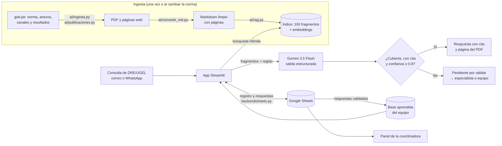

# Arquitectura de CdD Responde

## Cómo fluye una consulta

1. **Ingesta** (una vez, o cuando cambia la norma): `ai/ingesta.py` descarga de gob.pe la norma, sus modificatorias y "Canales de consulta"; `ai/publicaciones.py` lee las páginas de resultados por región y tramo.
2. **Conversión**: `ai/convertir_md.py` pasa los PDF a Markdown limpio, con el número de página impresa, las tablas de los Anexos 3-5 reconstruidas y cada nota al pie junto al párrafo que la llama.
3. **Índice**: `ai/rag.py` corta el texto por numeral, anexo y ficha técnica (193 fragmentos) y calcula sus embeddings con `gemini-embedding-001`.
4. **Consulta**: la app (`app/streamlit_app.py`) busca los fragmentos más cercanos (búsqueda híbrida: significado + palabras clave) y `ai/clasificador.py` le pide a `gemini-3.5-flash` una respuesta con salida estructurada (tema, indicador, IGED, si está cubierta, confianza y fragmentos citados).
5. **Decisión en código**: responde sola solo si la consulta está totalmente cubierta, cita al menos una fuente y la confianza es ≥ 0.8. Si no, queda "Pendiente por validar" y se deriva al especialista del indicador o al equipo transversal.
6. **Registro y aprendizaje**: `backend/sheets.py` registra cada consulta en Google Sheets. Cuando un especialista responde una pendiente y la marca "Respondido", su respuesta pasa a la base aprendida y se usa en las siguientes consultas parecidas.
7. **Panel**: la pestaña "Panel de la coordinadora" lee la misma hoja y muestra la carga pendiente, las regiones, los indicadores, los canales y el listado de consultas y respuestas, con filtros encadenados.
